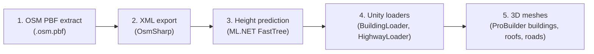

# OSMCity

OSMCity is a project made on Unity by myself about reconstructing buildings in cities from OpenStreetMap data, at an estimated height.

The User manual and State of the art are written in french.

**Tech stack:** C# · .NET · ML.NET · OsmSharp · Unity · ProBuilder

## Pipeline

1. **PBF**: a `.osm.pbf` extract of the target area is read with OsmSharp.
2. **XML**: it is exported to the XML files (nodes, ways, relations, tags) stored in `Assets/Resources/XmlFiles/`.
3. **Height prediction**: offline, buildings without a `height` tag get one predicted by an ML.NET regression model trained on the tagged ones (area, perimeter, floors, neighbors...), written to `Assets/Resources/TxtFiles/`.
4. **Loaders**: in Unity, `BuildingLoader` and `HighwayLoader` stream the XML files into an OSM object graph and read the predicted heights.
5. **3D meshes**: each building and highway is turned into a ProBuilder mesh, with roofs, colors and materials taken from its OSM tags.

## Screenshots

Here, an aerial view of the city of Vaduz in Liechtenstein inside my 3D model.

Here, an aerial view of the city of Luxembourg inside my 3D model with many buildings and highways.
